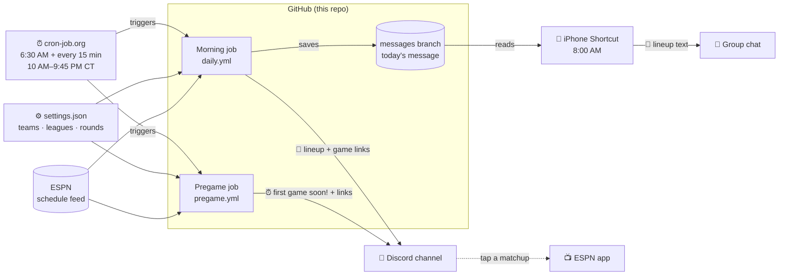
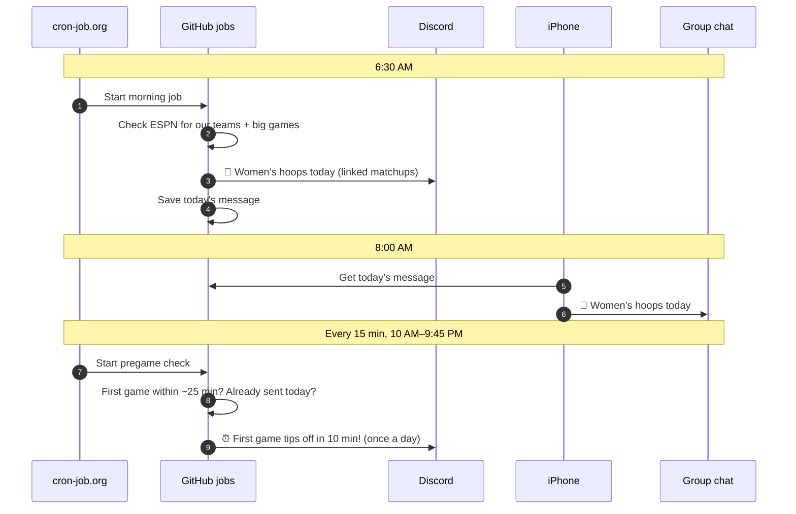

# Sports Reminder 🏀

Daily reminders for women's college basketball and WNBA games — posted to our Discord channel and texted to the group chat. Fully automatic, free, and edited from one settings file.

## How it works



### A game day



No matching games → nothing is sent anywhere.

## What gets a reminder

Set in [`settings.json`](settings.json):

| League | Our teams (all season) | Plus, for everyone |
|---|---|---|
| College | UConn, USC, South Carolina, LSU, Notre Dame | Every NCAA tournament game from the **Sweet 16** on |
| WNBA | Fever, Wings, Lynx | **Every playoff game** |

College teams show their AP Top 25 ranking (seed during the tournament).

## What the messages look like

**Morning text** (real output, Nov 10, 2026):
```
🏀 Women's hoops today

College
• #13 Notre Dame vs Detroit Mercy — 6:00 PM CT · ACCNX
• #9 LSU vs McNeese — 7:00 PM CT · SECN+
• #3 USC vs Charleston — 9:30 PM CT · BTN
```

**Discord** gets the same lineup with each matchup linked to its ESPN game page (opens the ESPN app), and again shortly before the first game:
```
⏰ First game tips off in 10 min!
```

---

## Changing things

Edit [`settings.json`](settings.json) on GitHub (pencil icon) or ask Claude. Nothing on the phone changes.

| To… | Change |
|---|---|
| Add/remove a team | the league's `my_teams` list, e.g. `["UConn", "USC", "Iowa"]` |
| Change pregame lead time | `pregame_minutes_before` |
| Turn rankings off | `"show_rankings": false` |
| Add a league (e.g. NBA) | one more block in `leagues` |

**Check any date:** Actions → **Daily reminder** → **Run workflow** → enter a date, untick **Post to Discord**. The result shows on the run page.

## If it stops working

| Symptom | Likely cause | Fix |
|---|---|---|
| Discord works, no texts | Phone key expired | New key (Setup 2), paste into the Shortcut header |
| Nothing anywhere | cron-job.org key expired or job failed | Check cron-job.org history; new key (Setup 6) |
| Texts arrive as a file | Shortcut sending the dictionary, not the text | Send must use **Message** = Dictionary Value `text` |

Keys to renew before they expire: **Hoops Shortcut** (phone) and **cron-job trigger** (cron-job.org).

---

## Setup (one time)

<details>
<summary><b>1 — Discord webhook</b></summary>

1. Discord: server → **Server Settings** → **Integrations** → **Webhooks** → **New Webhook**, pick the channel, **Copy Webhook URL**.
2. This repo → **Settings** → **Secrets and variables** → **Actions** → **New repository secret**: name `DISCORD_WEBHOOK`, paste the URL.
</details>

<details>
<summary><b>2 — Phone key (read-only)</b></summary>

github.com/settings/personal-access-tokens/new → **Fine-grained** → name `Hoops Shortcut` → Only select repositories → **Sports-Reminder** → Repository permissions → **Contents: Read-only** → Generate, copy (`github_pat_…`).
</details>

<details>
<summary><b>3 — The iPhone Shortcut</b></summary>

1. **Format Date** → Current Date, Custom, `yyyyMMdd`
2. **Get Contents of URL** → `https://api.github.com/repos/AI-Jess/Sports-Reminder/contents/days/`**Formatted Date**`.json?ref=messages`
   Headers: `Authorization` → `Bearer <phone key>` · `Accept` → `application/vnd.github.raw`
3. **Get Dictionary from Input** → Contents of URL
4. **Get Dictionary Value** → Value for `text` in Dictionary
5. **Set Variable** → `Message` = Dictionary Value
6. **If** Message (type: Text) **contains** `🏀`
7. → **Send Message** Message to the group chat (Show When Run off)
8. **End If**

The 🏀 check means no games, a missed job, or an error all stay silent. Reading `text` from the JSON keeps iMessage from sending it as a file.
</details>

<details>
<summary><b>4 — Test it</b></summary>

- **Discord:** Actions → **Daily reminder** → Run workflow, date `20260403`, Post to Discord ticked.
- **Phone:** temporarily replace step 1 with a **Text** action `20260403`, send to yourself, run.
</details>

<details>
<summary><b>5 — Daily phone automation</b></summary>

Shortcuts → **Automation** → **+** → Time of Day → **8:00 AM**, Daily → **Run Immediately**, Notify off → **Hoops Reminder**. Set it up on one device only, or the group gets doubles.
</details>

<details>
<summary><b>6 — On-time triggers (cron-job.org)</b></summary>

GitHub's free scheduler often runs hours late, so cron-job.org (free) starts the jobs on time. GitHub's own morning schedule stays as a backup; nothing ever posts twice.

1. **Key:** github.com/settings/personal-access-tokens/new → **Fine-grained** → name `cron-job trigger` → Only select repositories → **Sports-Reminder** → **Actions: Read and write** → Generate, copy.
2. **cron-job.org** → **Create cronjob**, twice:

| | Morning | Pregame |
|---|---|---|
| URL | `https://api.github.com/repos/AI-Jess/Sports-Reminder/actions/workflows/daily.yml/dispatches` | same, ending `pregame.yml/dispatches` |
| Schedule | Every day at 6:30 | Minutes `0,15,30,45`, hours `10–21` |

Both, under **Advanced**: time zone `America/Chicago` · `POST` · headers `Authorization: Bearer <key>`, `Accept: application/vnd.github+json`, `Content-Type: application/json` · body `{"ref":"main","inputs":{"scheduled":"true"}}`. Success = HTTP **204**.
</details>

## What's in the repo

| File | Does |
|---|---|
| `check_games.py` | Reads ESPN, picks games, builds messages, posts to Discord |
| `settings.json` | Teams, leagues, rounds, rankings, pregame lead time |
| `.github/workflows/daily.yml` | Morning job |
| `.github/workflows/pregame.yml` | Pregame check (and backup for a missed morning) |
| `messages` branch | Each day's message, read by the Shortcut |
